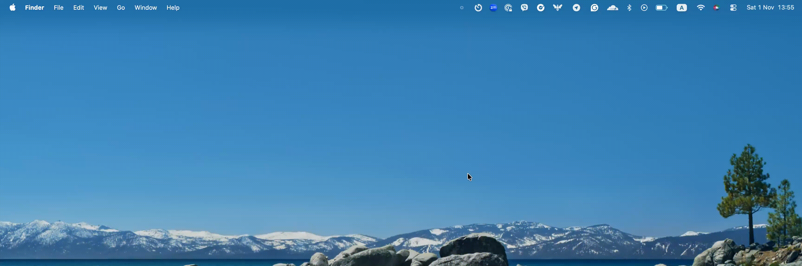

# Tick - macOS menu bar timer

Tick is a minimal macOS timer app designed for simplicity and functionality. It integrates seamlessly into menu bar with a transparent overlay and a dynamic progress bar, making it a perfect companion for staying productive



[](https://github.com/PNeizhmak/Tick/raw/refs/heads/main/Build/Tick%20App.dmg)
> ⚠️ **Note:**  
> Since the app isn’t notarized yet, macOS may prevent you from opening it. To run it, go to **System Settings > Privacy & Security** and allow it under the “Blocked Applications” section

## Table of contents

- **Features**
- **Install**
- **Usage**
- **Preferences**
- **Timer Presets**
- **Development**
- **Troubleshooting**
- **Roadmap**

## Features

- **Menu bar timer**: Lightweight status item with a clean, focused UI
- **Quick Start**: One-click timers for 1, 5, and 30 minutes, plus a custom duration window
- **Pause/Resume/Stop**: Control the active timer directly from the menu
- **Overlay progress**: Subtle progress overlay on selected displays while the timer runs
- **Multiple monitors**: Choose which monitors display the overlay
- **Sound toggle**: Enable/disable transition sounds
- **Timer Presets**: Create named presets with durations; start them from the menu
- **Auto-start chain**: Optionally auto-start the next preset when one finishes

## Install

1. Download the latest `.dmg` via the button above
2. Open the disk image and drag the app to Applications
3. If macOS blocks the app, follow the note above in Privacy & Security

## Usage

- Click the menu bar icon to open the menu
- **Quick Start**: choose 1, 5, or 30 minutes, or pick **Set Custom Duration…**
- When a timer is running, the menu shows remaining time and provides **Pause/Resume** and **Stop** controls
- Use **Timer Presets** to start a saved preset in one click

### Custom duration

- Select **Set Custom Duration…**, choose hours/minutes/seconds, and start

## Preferences

- Open the menu → **Preferences**
- **Sound transitions**: toggle on/off
- **Show Timer On**: choose which displays show the overlay while the timer runs

## Timer Presets

- Open the menu → **Timer Presets → Manage Presets…**
- Create presets with a name and duration
- Optionally enable **Auto-start next preset** and choose which preset runs next to build a chain (e.g., Pomodoro → Break)
- Presets appear under **Timer Presets** in the menu for one-click start

## Development

### Requirements

- Xcode (recent version recommended)
- macOS (recent version recommended)

### Build & run

1. Clone the repository
2. Open `Tick.xcodeproj` in Xcode
3. Select a signing team if needed
4. Build and Run

Alternatively, via command line:

```bash
xcodebuild -project Tick.xcodeproj -scheme Tick -configuration Release
```

### Project overview

- `Core/` app lifecycle and coordination
- `Managers/` timer logic, menu, preferences, status bar
- `Controllers/` timer overlay and timer orchestration
- `Views/` SwiftUI views for custom duration and preset management

## Troubleshooting

- **App won’t open**: Allow the app in System Settings → Privacy & Security (see note at the top)
- **No overlay on a display**: Check the selected displays under Preferences → Show Timer On
- **No sound**: Toggle sound transitions in Preferences
- **Timer pauses when opening the menu**: The timer is designed to continue running while the menu is open; if you observe otherwise, please open an issue with steps to reproduce

## Roadmap

- App notarization and auto-updates
- Import/export presets; preset categories and icons
- Optional global shortcuts
- Stats/history of completed timers
